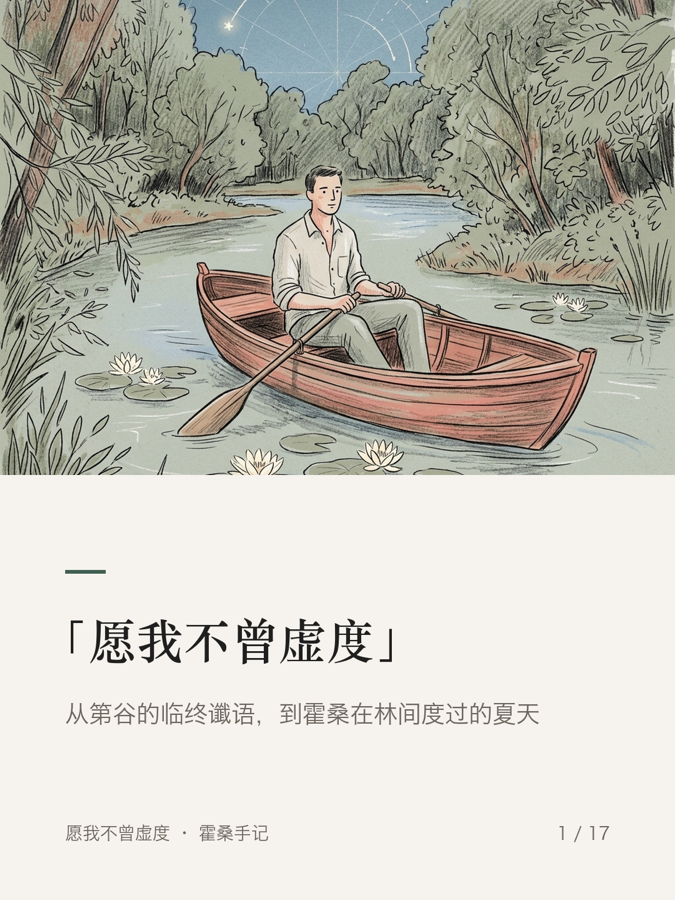
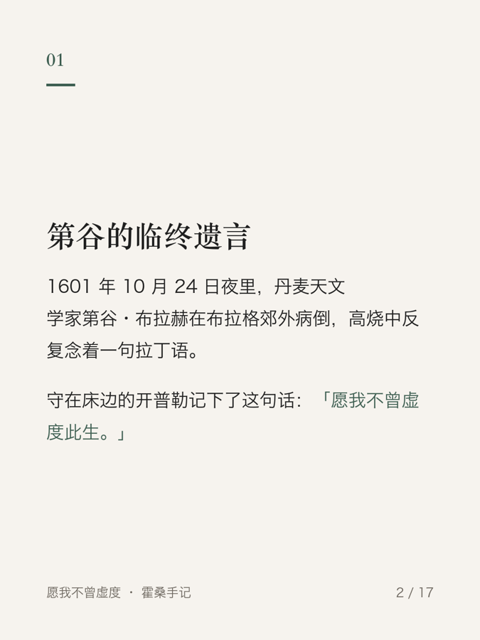

# zh-longform

一个 [Claude Code](https://claude.com/claude-code) Skill，用来写中文长文，并从同一份母稿发到 X Article、小红书和微信公众号。

它管的是整条流水线：选题门禁 → 调研 → 写作 → 独立审读 → 封面 → 派生平台版本 → 质检 → 交付，外加小红书轮播图和策展卡片。规则写在 Markdown 里，排版和质检交给脚本，需要人拍板的地方（看封面、出不出轮播图）一律停下来问你。

| 小红书封面 | 公众号封面 | 轮播图封面卡 | 轮播图正文卡 |
| --- | --- | --- | --- |
|  |  |  |  |

## 能做什么

- **写作规范**：选题要过信息增量门禁；特稿靠一手物证说话，教程从真实麻烦出发；附一份病句对照改写库，专治翻译腔和 AI 味。
- **独立审读**：审读交给一个全新的 Subagent，逐项过阻断清单、逐句列修改表，结论只有「通过」和「退回」。
- **一张母稿，两种封面**：AI 只画一张无字插画，脚本排出小红书 1440 × 2400 和公众号 900 × 383 两版，标题按实际字宽断行。
- **平台派生**：小红书版附敏感词改写表和防限流要点；公众号版转成内联样式 HTML。
- **小红书轮播图**：精简版按重点切卡；全文版把整篇文章一字不删排成图，超过 18 张自动拆成多篇。
- **质检脚本**：标题一致性、图片路径、盘古之白、错字、敏感词、外链、导流话术、封面尺寸和看图记录。

## 安装

需要 Python 3.9+ 和 Pillow。

```bash
git clone https://github.com/Yann-ar/zh-longform ~/.claude/skills/zh-longform
pip3 install -r ~/.claude/skills/zh-longform/requirements.txt
```

装好后在 Claude Code 里输入 `/zh-longform`，或者直接说「帮我写一篇长文」。

### 字体

脚本默认用 macOS 自带的宋体（Songti SC）和冬青黑体（Hiragino Sans GB）。其他系统用环境变量指定中文字体，格式为「路径」或「路径#字面索引」：

```bash
export ZH_LONGFORM_TITLE_FONT=/path/to/serif-bold.ttf          # 封面标题
export ZH_LONGFORM_SERIF_BOLD="/usr/share/fonts/NotoSerifCJK-Bold.ttc#0"
export ZH_LONGFORM_SERIF_REGULAR="/usr/share/fonts/NotoSerifCJK-Regular.ttc#0"
export ZH_LONGFORM_SANS_REGULAR="/usr/share/fonts/NotoSansCJK-Regular.ttc#0"
export ZH_LONGFORM_SANS_BOLD="/usr/share/fonts/NotoSansCJK-Bold.ttc#0"
```

封面标题推荐京華老宋体（KingHwa_OldSong，作者特里王）。它可免费商用但不是开源字体，所以本仓库不附带，需要自行下载。没装时脚本自动退回系统宋体。

### 可选依赖

公众号 HTML 用第三方 Skill `baoyu-markdown-to-html`（来自 [baoyu-skills](https://github.com/JimLiu/baoyu-skills)）的 qqtech 主题，需另行安装。不发公众号可以不装。

## 快速开始

在一个空目录里打开 Claude Code，说「在这里新建一个长文写作项目」，Skill 会运行：

```bash
python3 ~/.claude/skills/zh-longform/scripts/init_project.py .
```

得到：

```text
.
├── AGENTS.md
├── 01_选题/选题池.md
├── 02_调研/资料索引.md
├── 03_写作/进行中/
└── 05_待发表/
```

之后按阶段说话就行：

| 你说 | Skill 做 |
| --- | --- |
| 「这个选题能不能写：……」 | 用选题门禁逐条检验，写进选题池 |
| 「开始写」 | 复制模板，按写作规范写特稿或教程 |
| 「做封面」 | 写母稿提示词，等你画图，派生两版封面 |
| 「审一下这篇」 | 开独立 Subagent 审读，输出 `审读.md` |
| 「也发小红书和公众号」 | 派生平台版本，跑质检 |
| 「输出两种轮播图」 | 出精简版和全文版小红书轮播图 |
| 「交付」 | 列出全部交付文件和缺项 |

## 封面怎么画

Claude Code 默认没有生图工具，所以封面分三步：

1. Skill 运行 `generate_covers.py --prepare`，生成母稿提示词，里面会写上画风样板 [`assets/style-sample/hawthorne-master.png`](assets/style-sample/README.md)。
2. **你**把提示词和样板图片文件一起交给任意能接收参考图的生图工具，画一张约 1:1 的无字插画。
3. 把图发回给 Claude，Skill 用 `--master` 排出两版封面，再由你看图确认。

想换成自己的画风，设置 `ZH_LONGFORM_STYLE_SAMPLE` 指向你的样板图，并改写 `rules/平台与封面.md` 第五节的画风描述。

## 仓库结构

```text
zh-longform/
├── SKILL.md                 # Skill 入口：阶段路由和门禁
├── references/              # 7 份分阶段流程参考
├── rules/                   # 写作规范、中文对照改写库、平台与封面
├── templates/               # 文章、caption、审读、小红书图片、策展卡片、选题池等模板
├── scripts/                 # 封面、轮播图、卡片、质检、初始化脚本
│   └── tests/
├── assets/style-sample/     # 封面画风样板
└── docs/examples/           # README 里的示例图
```

## 直接用脚本

所有脚本都能脱离 Claude 单独跑，在写作项目根目录运行：

```bash
S=~/.claude/skills/zh-longform/scripts
$S/verify_article.sh "05_待发表/<主题>"                                   # 质检
python3 $S/generate_covers.py "05_待发表/<主题>" --prepare --preset yellow \
  --scene "具体动作" --relation "和文章的关系"                             # 母稿提示词
python3 $S/generate_covers.py "05_待发表/<主题>" --master master.png --focal 0.5,0.5
python3 $S/generate_xhs_slides.py "05_待发表/<主题>"                       # 精简版轮播图
python3 $S/generate_xhs_slides.py "05_待发表/<主题>" --full                # 全文版轮播图
python3 $S/generate_curated_cards.py --demo                                # 策展卡片样张
```

运行测试：

```bash
python3 -m unittest discover -s scripts/tests
```

## 致谢

去 AI 味的审读思路参考过这些开源项目，本仓库没有复制它们的文字：

- [LifelongLazyLearner/qu-ai-wei](https://github.com/LifelongLazyLearner/qu-ai-wei)（MIT）
- [sirambrosio/humanink](https://github.com/sirambrosio/humanink)（MIT）
- [op7418/Humanizer-zh](https://github.com/op7418/Humanizer-zh)（MIT），独立审读时可以配合使用
- 公众号排版依赖 [JimLiu/baoyu-skills](https://github.com/JimLiu/baoyu-skills) 的 `baoyu-markdown-to-html`（MIT）

## 许可证

[MIT](LICENSE)。画风样板和 `docs/examples/` 里的示例图是作者为自己的文章用 AI 生成的插画和排版成品，随仓库以同一许可证提供。示例图里的标题和正文文字也是作者本人的作品。仓库不附带任何字体文件；示例图用 macOS 自带字体渲染。
